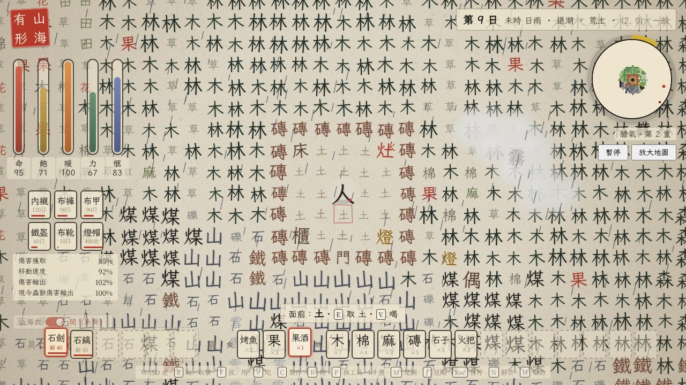

# 山海有形 · Shanhai Youxing

> 字裡行間 · 一紙之島　　寫木為舟 · 寫水成淵
>
> *Where Mountains and Seas Take Form.*
>
> **「寫意」系列 · 第一部**

> 鳥棲於山，是為島。一張紙落在海上，紙上的字活了。你是其中的一個「人」，赤手空拳。

一個**由漢字構成的 2D 生存與探索沙盒**。山就是「山」字，水就是「水」字，樹是「木」，林是「林」，虎是「虎」。收集、製作、砌牆，撐過一夜又一夜；探索小島上的八處地方，讀完它們留下的話；膽氣夠了，就造一艘大船，開出這張紙。

純瀏覽器單頁遊戲，零依賴，雙擊就能玩，全繁體（台灣用語）。

本作是**「寫意」遊戲系列**的第一部。「寫意」是系列名，之後可能再出系列的其他遊戲；系列各作的內部識別名都以 `xieyi` 起頭。




---

## 目錄

- [立刻開玩](#立刻開玩)
- [遊戲介紹](#遊戲介紹)
- [操作手冊](#操作手冊)
  - [按鍵](#按鍵)
  - [畫面](#畫面)
  - [第一天怎麼過](#第一天怎麼過)
  - [六條數值與膽氣](#六條數值與膽氣)
  - [製作](#製作)
  - [工具](#工具)
  - [衣甲與山海衣](#衣甲與山海衣)
  - [夜、獸與魄](#夜獸與魄)
  - [天氣：雨與霧障](#天氣雨與霧障)
  - [海：船、首骨、蜃、落水](#海船首骨蜃落水)
  - [夥伴、龜卜、煉丹](#夥伴龜卜煉丹)
  - [島上八處](#島上八處)
  - [死亡、難度、渡海](#死亡難度渡海)
- [開發者](#開發者)

---

## 立刻開玩

- **線上**：https://claude.ai/artifact/AaW9h52xsssPP5beWgBErX （拿到連結的人都能開）
- **本機**：下載或 clone 這個 repository，**雙擊 `index.html`** 就能玩。也可以起一個本機伺服器：

  ```bash
  python3 -m http.server 8123     # 然後開 http://127.0.0.1:8123/
  ```

- 起始頁有**三格存檔**，每格寫著島號、難度、第幾日第幾夜、膽氣第幾重、死過幾次、睡過幾夜、存檔時刻。點一格選它：「繼續」讀那一格；選難度、輸入**世界種子**（同一個種子長出同一座島），按「落筆」把新島寫進那一格（格裡有存檔會先問一聲，再按一次才覆蓋）；「刪」也要按兩次。回車等於選著的格有存檔就繼續、沒有就落筆。
- 網址參數：`?seed=123` 指定種子；`?slot=2` 選第二格；`?autostart=1` 跳過起始頁。
- **存檔**在瀏覽器本地，每二十秒自動存一次，切到背景或關掉頁面也會存。渡海「再來一座島」會清掉那一格，膽氣帶到下一座島。
- 書法字體「霞鶩文楷 TC」從 Google Fonts 線上載入；離線時退回系統的標楷體，照常能玩。

---

## 遊戲介紹

**一紙之島。** 每座島都由種子程式生成：海、灘、沙、礫、石、山、雪、草、田、木、林、森、竹、棉、麻、果，還有山裡的煤層與鐵礦脈。地圖只畫你走過的地方。潮水一天漲落一次，退潮時才露出一條沙路，通往島外小嶼上的燈。

**活下去。** 命、飽、暖、力、愜意五條數值，加上一條代表成長的「膽氣」。夜裡冷，獸會出來；餓了要吃，累了要歇，悶了要找點事做。

**製作與建造。** 四十六條配方，分成居所、工具、神兵、衣甲、燈火、漁船、食藥、材料八類：磚、門、床、灶、櫃、稻草人、橋；石器、鋼具、鎢鋼具；布、鐵、鎢鋼三等衣甲；火把、蠟燭、燈、燈帽；漁網、魚梁、竹筏、孤帆、方舟；藥、果酒、丹。

**夜與獸。** 虎、豹、狼、蛇、蜘蛛、蟾蜍，各有各的脾氣。第十三夜起，穿牆、怕光的「魄」夜行：牆擋得住獸，擋不住魄，只有光才行。例外是**小屋**：牆與門圍起的小空間，裡面不生生靈，獸進不來；夠小的話連魄也進不來，多小才算看難度，困難的魄什麼牆都擋不住。

**天氣。** 雨不分晝夜，會澆壞屋外的燈；附近不時起一片霧障，不帶扇子硬闖，五樣數值各掉一成。霧會慢慢飄，躲著燈火，也躲著手裡有光的你；沒帶光的人，會被霧追上。

**海。** 海上有吞吐霧障、會撞船的「蜃」。殺虎豹狼偶爾得到牠們的首骨，放在船頭，蜃就不敢近；船毀了，只有六十息游上岸。

**成長。** 膽氣一圈一重：八重造船，十六重五件衣甲穿齊（其中至少一件鎢鋼）便是「山海衣」（衣上浮出《山海經》的獸紋），卅一重可鑄兩件神兵：陸上的撼地之鎚「九閽鳴雷」，海上的「燭龍焚溟」。

**夥伴與探索。** 山間的鷹可以用魚馴服，替你打獸；洞裡的龍讀了就跟你走。島上八處地方，各留了一段話。

**名字。** 山就是「山」，水就是「水」，象形字本來就有形，所以叫「山海有形」。「寫意」原是最早「組字造詞」版本的名字，現在是整個系列的名字，《山海有形》是「寫意」系列第一部；改名的來由寫在 [`docs/SPEC.md`](docs/SPEC.md) §2.2。

---

## 操作手冊

### 按鍵

| 鍵 | 作用 |
| --- | --- |
| `W A S D` / 方向鍵 | 走（可斜走，面朝最後按的方向） |
| `E` / 空白 | **取**（按住可連取）、攻擊（船上也能打蜃）、揮燭龍焚溟、捉魚、讀碑讀地標、問路（面向門）、取魚梁與漁網的魚、空網收回、撿荷包、開櫃、上船、拆稻草人、鋤在手時鋤地、空瓶取水、掄九閽鳴雷 |
| `F` / Enter | 面向灶：**開灶**，在界面裡添柴、烤、燒瓶、蒸餾、煉鐵煉鎢鋼。面向停著的船：首骨放上船頭、木板補船。**放**：放到地上、放到鼎上（添柴、煉丹）、下漁網、手持魚對鷹投魚、穿衣甲、把工具移進具欄、續稻草人 |
| `V` | 船上：首骨放上船頭、木板補船。**用**：吃、喝、穿衣甲、服丹、龜卜、用錦囊、拿蠟燭續燈帽、拿扇子吹散三格內的霧障 |
| `C` | 製作面板（左邊選大類；數字鍵直接造眼前這一欄的前九條） |
| `R` | 夜裡面向床，睡到天明 |
| `P` | 換手持的工具（轉一圈回到空手） |
| `1`–`9` | 選囊的格子（製作面板開著時改為直接造） |
| `Tab` `Z` `]` ／ `Q` `[` ／ 滾輪 | 囊裡的下一格／上一格 |
| `M` | 全島地圖 |
| `J` | 見聞錄（地方、生靈、日子） |
| `H` | 幫助 |
| `N` | 靜音 |
| `Esc` | 關掉面板；沒有面板時暫停／繼續 |
| `+` `−` | 字格放大縮小 |
| `Y` ／ `N` | 霧障彈窗：用扇子／不用 |

**手柄**（v0.15）：藍牙或 USB 把手柄連上電腦，開著遊戲按一下手柄上任一鍵，瀏覽器才會把它交給遊戲，畫面會提示「手柄已連上」。預設照 Nintendo 布局：

| 手柄 | 做什麼 |
| --- | --- |
| 左搖桿／十字鍵 | 走 |
| `A`（右） | 取／攻擊／讀／開櫃／上船；面板裡按下選中的鈕；彈窗裡等於 Enter |
| `B`（下） | 關掉面板／彈窗；沒開面板時暫停 |
| `X`（上） | 放／用／開灶（F） |
| `Y`（左） | 吃喝、穿衣甲、服丹、用錦囊（V） |
| `L`／`R`、右搖桿左右 | 上一格／下一格囊 |
| `ZL` | 換工具（P） |
| `ZR` | 攻擊（E，按著連打） |
| `＋` | 製作（C） |
| `－` | 地圖（M） |
| 左搖桿按下 | 見聞錄（J） |
| 右搖桿按下 | 睡（R） |

面板開著時（製作、櫃、灶、幫助、暫停、起始頁……）十字鍵或左搖桿在鈕與格子之間移紅框焦點，`A` 按下，`B` 關。手柄一連上，畫面最下面那行按鍵說明就換成手柄的。瀏覽器認得的手柄（Switch Pro、Xbox、PS 多半是）直接能用；對應不是標準的第三方手柄，第一次按鍵會自動進「手柄對應」精靈，照提示一顆一顆按（搖桿推到底），學完存在這個瀏覽器裡，下次直接用。起始頁、暫停面板、幫助裡都有「手柄對應」，可以隨時重新檢測每一顆鍵或改回標準。精靈最下面一行與暫停面板最下面一行都即時顯示瀏覽器看到的東西：幾鍵幾軸、按著哪幾顆鍵、每根軸的值（離閒置超過 0.3 的標 ★）、遊戲判定成哪個方向與哪些鍵、現在的對應表；方向不對時，推著搖桿看哪根軸標了 ★，抄下那一行就能對。十字鍵做成一根「帽子軸」（閒置 3.29 或 0、八個位置各一個值）、扳機做成軸、搖桿只有半幅、搖桿做成四顆按鍵、閒置不在正中的手柄都認得；精靈把方向學錯了，沒被綁走的標準十字鍵與左搖桿仍然能走。

**暫停**（`B` 或 `Esc`）面板裡有「繼續」「活下去的法子」「手柄對應」「回到主頁」；回到主頁會先存檔，再回起始頁的三格存檔。手柄不聽話時，暫停面板還有一排工具：「校正中點」（以現在搖桿停的位置當零點，搖桿閒置不在零、人自己走的時候用）、「對調左右搖桿」、「左搖桿上下反向」「左搖桿左右反向」、「錄八秒讀數」（錄下每根軸的閒置與最小最大、按過的鍵、幾鍵幾軸、手柄 id，自動複製到剪貼簿，貼給開發者就能對症）。推到底只動一點點的搖桿，精靈按住一秒多也收得到，並照幅度放大。
| 滑鼠 | 左鍵點相鄰格＝`E`，右鍵＝`F`；點囊格選中（工具則移進具欄）；點具欄格手持、再點空手、右鍵移回囊；點身上的衣甲脫下、右鍵修補；點小地圖放大 |

### 畫面

- **左上**：紅印「山海有形」；五條直條是命（紅）、飽（黃）、暖（橙）、力（綠）、愜意（藍），條上有 25%、50%、75% 三道尺標。下面是**身上**：上排內襯、褲、甲，下排盔、靴、燈帽，每格寫著還能穿幾日；再下面四行：傷害獲取、移動速度、傷害輸出、現今蟲獸傷害輸出。
- **左下**：山海衣的滑動開關。
- **右上**：狀態列（第幾日、時辰、日月、下雨時的「雨」字、第幾夜與「魄夜」、潮汐、所在地名、座標、難度）；圓形小地圖，外圈金色弧是這一重膽氣的進度；「暫停」與「放大地圖」兩個鈕。
- **右側**：夥伴面板，馴了的鷹一隻一欄，兩條直條是命與力。
- **下方**：提示列（面前是什麼、能做什麼）；左邊六格**具欄**放工具（有耐久的工具外面包一圈耐久環，剩多少畫多少，低於四分之一轉紅），右邊**囊**分「食」「物」兩段，共用十六格。
- **畫面邊緣**：掉血泛紅、中毒泛綠、神志不清泛藍。

### 第一天怎麼過

1. **取材料**：面向樹按 `E` 得木，面向草得草，土得土；碎石地「礫」得石子，石地得石；野棉、野麻得棉、麻；果樹得果，可以直接吃。
2. **磨一把工具**：按 `C`，在「工具」類選磨礪（石一、石子一、木一），挑石劍防身或石鎬鑿山。工具自動放進具欄，`P` 換手持。
3. **做火把**：石子一、草三、木二，一次四根。夜裡拿在手上才亮，虎豹怕光。
4. **蓋屋**：磚＝土二草一，一次兩塊；門＝木三。砌一圈磚，留一扇門，獸就進不來。
5. **床與灶**：床＝棉六木二，夜裡面向它按 `R` 睡到天明，睡一覺力全回、愜意 +20。灶＝石六，面向它按 `F` 開灶，在界面裡添柴，火旺時把魚、肉烤熟（生吃傷身）。
6. **紮一把扇子**：草四木一。第二天起可能起霧障，帶著它就不怕。
7. **第十三夜前**：備好火把或蠟燭（棉一肉一），或做一頂燈帽（麻布二蠟燭一）戴在頭上。燈（石二火把一）放在屋裡長明不滅，放在屋外會被雨澆壞。
8. **去探索**：找到「塔」登上去，全島都會畫到地圖上；面向村口的門按 `E` 可以問路。

### 六條數值與膽氣

五條數值不到五成，那條的外框每兩秒閃一下黃；不到四分之一每秒閃一下紅，並彈窗提醒一次（回到五成以上後才會再提醒；困難只閃不提醒）。

| 數值 | 會掉 | 會回 | 歸零 |
| --- | --- | --- | --- |
| 命 | 餓、凍、力盡、中毒、被撲被咬、生食 | 飽、愜意、力都在八成以上時慢慢回；泉邊、井水、藥、睡覺 | 死 |
| 飽 | 一直慢慢掉，睡一覺 −12 | 果 20、烤魚 40、烤肉 55（另補命 +10）、烤蛇 30（另補命 +8）、果酒 12、淡水 6 | 每秒掉兩滴命 |
| 暖 | 夜裡、雪上、水裡；穿內襯減半、手持火把再減 | 白天、灶邊火邊、屋裡、泉邊、睡覺 | 每秒掉三滴命 |
| 力 | 取一次、打一下各一點；製作看配方 | 每兩息回一點；睡覺全回；讀碑上限 +10 | 每秒掉兩滴命，什麼都做不了 |
| 愜意 | 每十五息一點；附近有魄而手上無光時掉得很快；殺龜 −30 | 製作 +8（同一配方六十息內再做依次 4、2、1）、睡床 +20、果酒 +20、烤蟾 +10、讀地標 +10；每分鐘聽見鹿呦、鳥鳴、海浪各 +1 | 神志不清：一陣能控一陣失控，失控時亂走 |

**膽氣**是成長：採集天然的東西、製作、捉魚、擊敗野獸、讀地標都會長；右上小地圖一圈一重，越高命、力、愜意回得越快（十重兩倍）。**廿二重起只從斃敵對的生靈得來**，製作、採集、讀碑都不再長；斃敵對生靈的膽氣白日只有八成、夜裡加半成（鹿與龜不算敵對），夜裡出門才長得快。升一重要的點數一重比一重多：20、24、29、34、39……八重共 300、十重共 437。

- **八重**：可以造船：孤帆與方舟。
- **十六重**：五件衣甲穿齊、其中至少一件鎢鋼護具，便是山海衣（見下）。
- **卅一重**：可以鑄神兵九閽鳴雷與燭龍焚溟。過了卅一重，膽氣三日一減，不低於卅一重；身上帶著九閽鳴雷則二日一減、可減到廿五重。
- **死亡**：膽氣減六成，留四成。

所有算出小數的數值都四捨五入到個位，畫面上看到的數字就是實際算的數字。

### 製作

按 `C` 打開製作面板，左邊選大類，右邊每條寫著材料、耗力與用途；材料或力不夠的會變灰。數字鍵 `1`–`9` 直接造眼前這一欄的前九條。完整的四十四條配方表在 [`docs/SPEC.md`](docs/SPEC.md) §4.2。

| 大類 | 常用配方 |
| --- | --- |
| 居所 | 磚 ×2＝土二草一；門＝木三；床＝棉六木二；櫃＝石四木四（二十四格）；灶＝石六；鼎＝鐵三石四鎢鋼一精煤二；稻草人＝麻布二石子二木三草四；橋 ×2＝木四 |
| 工具 | 扇＝草四木一；磨礪石器＝石一石子一木一；重磨＝石子一；鍛鋼具＝鐵二木一煤一；鍛鎢鋼具＝鎢鋼二木一精煤一（還要飽十以上）；九閽鳴雷＝鐵十二煤六石子九麻布二果酒一（卅一重）；燭龍焚溟＝鎢鋼四精煤六火把四海水瓶三（卅一重） |
| 衣甲 | 內襯＝棉四麻二；布褲、布甲、布帽、布靴用麻布與棉；鐵甲＝鐵五麻布一；鐵盔＝鐵三；鐵靴＝鐵二麻布一；鎢鋼甲盔靴同鐵件，鐵換成鎢鋼 |
| 燈火 | 火把 ×4＝石子一草三木二；蠟燭 ×2＝棉一肉一；燈＝石二火把一；燈帽＝麻布二蠟燭一 |
| 漁船 | 漁網＝棉二麻二草三；四小網成中網，四中網或十三小網成大網；魚梁＝竹四草二；竹筏＝竹六；木板 ×2＝木二；船槳＝木板二木一；船帆＝麻布四木二；孤帆＝木板八船槳一船帆一（八重）；方舟＝木板三十六船槳四船帆三鐵八麻布六鎢鋼二（八重） |
| 食藥 | 藥＝草三果一（療傷 +35、解毒）；果酒＝醉果二淡水瓶一 |
| 材料 | 麻布＝麻四棉二；錦囊＝麻布三棉二（最多用四個，用滿後製作欄標「已用完」）；精煤＝煤八 |

重磨：同一把工具第一次石子一，再來二、四、八，八為上限；換一把從一算起。製作欄的「重磨」那列會寫手上這把是第幾次、要幾顆。

**灶**：面向灶按 `F` 開灶，一個界面：上面寫火還能燒幾息，「添柴」列出囊裡能燒的（木類、煤、精煤，各寫加幾息），「烤、燒、煉」列出囊裡能處理的，點一下就做；冷灶或材料不夠的按鈕是灰的。能做的事：魚、肉、蛇肉、蟾蜍肉烤熟；沙三燒成兩個玻璃瓶；海水瓶蒸餾成淡水；鐵礦二加煤一煉成鐵；鎢礦一加鐵礦二、精煤一煉成鎢鋼。舊的內襯、布褲、布甲、布帽、布靴也能當柴，一件一百二十息；舊的鐵甲、鐵盔、鐵靴、鋼具在旺灶裡「熔」回鐵（甲回配方的一半、盔靴與鋼具各一塊），鎢鋼件熔回鎢鋼，石具與神兵不熔。界面開著時世界照常走、火照常燒；`E`／`F`／`Esc` 離開，走開或灶被拆了也會自己關。**櫃**：石四木四，二十四格，面向按 `E` 開。櫃裡的「拆下」連東西一起拆回囊裡（囊裡那格寫著幾樣），重放回去東西都還在；裝著東西的櫃不能放進別的櫃。**拆東西先問**：自己放的磚、門、床、燈、灶、鼎、櫃、橋、魚梁、漁網、稻草人，拆回之前都會跳出來問一聲，`Y`／Enter 拆、`N`／Esc 不拆，手柄 A 拆 B 不拆，免得手滑。**瓶**：空瓶面向水取海水，面向泉或井取淡水。**錦囊**：選中按 `V` 用掉，囊永久多兩格、具欄多一格，最多四個（二十四格與十格）。

### 工具

| 等級 | 刀 | 劍 | 鎬、鋤、斧 | 耐久 | 怎麼來 |
| --- | --- | --- | --- | --- | --- |
| 石器 | 30 | 40 | 15 | 40 | 石一石子一木一磨礪 |
| 鋼具 | 42 | 56 | 21 | 56 | 鐵二木一煤一鍛造 |
| 鎢鋼具 | 63 | 84 | 32 | 112 | 鎢鋼二木一精煤一鍛造 |
| 九閽鳴雷 | — | 120（三格內諸獸同受；打蜃減半） | — | 199 | 卅一重方可鑄、可掄 |
| 燭龍焚溟 | — | 120（三格內同受灼燒；海中之物全傷，陸上天上減半） | — | 199 | 卅一重方可造、可揮 |

- **鎬**：山、磊、煤層、鐵礦脈都要鎬；採石地、拆磚快一倍。**斧**：伐木伐竹快一倍。**鋤**：面向土或草按 `E`，鋤成田。
- 用一次掉一點耐久，鈍了用石子重磨（鎢鋼具重磨要力八、飽十）。
- 鐵礦脈鑿下去有三十分之一的機會挖到**鎢礦**；煤八塊煉成一塊**精煤**。

### 衣甲與山海衣

一套五件：內襯、褲、甲、盔、靴；另有帽格給燈帽，與盔不衝突。囊裡選中按 `F` 或 `V` 穿上，點身上的格子脫下。同一類只能有一件，再造一件只是翻新。

| 件 | 布 | 鐵 | 鎢鋼 |
| --- | --- | --- | --- |
| 內襯 | 減傷 2%，禦寒減半 | — | — |
| 褲 | 2% | — | — |
| 甲 | 3% | 14% | 22% |
| 盔 | 布帽 2% | 7% | 11% |
| 靴 | 1% | 5% | 8% |
| 壽命 | 180 日 | 180 日 | 360 日 |

- **鐵件**（鎢鋼也算）：每多一件，走得慢一些、攻擊高一些、飢愜力掉得快一些；甲、盔、靴三件齊時慢四分之一、攻擊加半成、消耗快八分，而且**毒不侵**。
- **損耗**：只有穿在身上才會舊。十五息內挨打越多下壞得越快（1.05、1.12、1.2、1.5 倍），第五下甲、內襯、褲直接碎掉；加快的速度會留下來，最多六倍。面板上的「N 日」是照目前速度算的。**右鍵**身上的格子修補：布件用麻布一、鐵件用鐵一、鎢鋼件用鎢鋼一，壽命回滿。
- **山海衣**：膽氣十六重以上、五件穿齊、其中至少一件鎢鋼護具（甲、盔、靴任一），衣上便浮出獸紋。七格內主動攻擊你的獸慢一倍、卻狠三分之二；你的攻擊 ×1.15，每過七重（二十三、三十、三十七）攻擊再 ×1.15、受傷再 ÷1.15。剛穿齊時近身挨打反而更痛，換來的是獸慢、好躲、好打。左下角的開關可以隨時關成普通服。

### 夜、獸與魄

| 生靈 | 命 | 脾氣 | 擊敗得到 |
| --- | --- | --- | --- |
| 鳥、魚 | 10 | 鳥見人就飛；魚面向按 `E` 捉 | 魚 |
| 鹿 | 30 | 見人就逃，黃昏往泉走 | 肉 ×2 |
| 龜 | 50 | 水邊少見，不咬人 | 龜甲 |
| 鷹 | 60 | 半友好：不惹不啄，打牠就反啄；可馴 | — |
| 蛇 | 90 | 草木之交，主動咬，有毒 | 蛇肉 |
| 蜘蛛 | 90 | 除草時偶爾驚出，不惹不咬 | — |
| 蟾蜍 | 90 | 水邊；紅字有毒會反咬，生吃都中毒 | 蟾蜍肉或毒蟾肉 |
| 豹 | 160 | 林中，快，畏火與光，一撲十 | 肉 ×2，偶有豹首骨 |
| 狼 | 160 | 夜裡成群，不怕火，磚與門擋得住，一口十 | 肉 ×2，偶有狼首骨 |
| 虎 | 300 | 森中，夜行，畏火與光，一撲二十 | 肉 ×3，偶有虎首骨 |
| 蜃 | 900 | 只在海上：撞船一下二十五，咬落水的人一口三十，吞吐霧障 | 膽氣 +40 |
| 龍 | 500 | 讀「洞」放出，跟你走，夜能照路 | 不可殺 |

- **毒**：蛇、蜘蛛、毒蟾咬一口，五秒內每秒掉血；兩口相隔不過六息算連咬，連咬滿十五口必死。藥可解毒。
- **小屋**：牆與門圍起來的小空間（門算牆，從裡面任一格數得到的能走的格子），裡面不會生出生靈，除了你誰也進不來。多小才算看難度：簡單 28 格以內擋獸（鳥、鷹、龍也算）、18 格以內連魄也擋；一般 18 格擋獸、8 格擋魄；困難 10 格擋獸，魄什麼牆都擋不住，只有光。馴了的鷹與龍會在屋外等你。拆掉一面牆、把屋子接大，就不算了。
- **魄**：第十三夜起（簡單第二十一夜、困難第九夜）夜行。無形、穿牆（夠小的小屋除外，看難度）、打不著，不傷身而蝕心：四格內你手上無光，愜意與力都掉得很快。**六格內有光就煙滅**：手持火把或蠟燭、頭戴燈帽、地上有燈或旺灶，龍只驅四格。白天藏在林裡。附近有魄睡不著。
- **稻草人**：放下後三十天內獸不近身（前半十格、後半七格），再放一個續到四十天；擋不住魄。

### 天氣：雨與霧障

- **雨**：白天黑夜都會下，一場四分之一到一日，停後一到四日再來，狀態列會多一個「雨」字。屋外的燈每盞每息有千五分之一的機會被雨澆壞，澆壞就沒了；四面有牆圍起來的屋裡（門也算牆）不怕。
- **霧障**：第二日起，每天兩次、每次四分之一的機會，附近的陸地上起一片十格上下、形狀不定的霧，一日後自己散。走進去會跳出彈窗：
  - 有扇子：選「用一把扇子吹散」（整片散，花一把），或「不用，硬闖」。
  - 沒有扇子，或選了不用：命、飽、暖、力、愜意各掉當前的一成（四捨五入，不會致命）。
  - 同一片霧裡走動不再問，走出去再進來才再問。扇子選中按 `V` 也能先吹散三格內的霧。
- **潮汐**：退潮時灘是沙，漲潮時是水；困在灘上可以涉水走到相鄰的灘。船、魚梁、漁網不能放在灘上（退潮會擱淺）；橋可以，架了漲潮也走得過。

### 海：船、首骨、蜃、落水

- **島很大**：半徑約八十五格，海一直到一百一十三格外，走到那裡便渡海而去。退潮時一條沙路通往島外小嶼上的燈。
- **兩種船**：**孤帆**一乘二，命一百二十，船頭放得下兩個首骨，木板八、槳一、帆一就能造；**方舟**二乘三，命四百二十，船頭放得下五個首骨，要木板三十六、槳四、帆三、鐵八、麻布六、鎢鋼二，船快只有孤帆的六成。船身每一格都要是真的淺水才放得下；行船時船身也要容得下，方舟過不了窄水道。
- **修船**：選中木板按 `F`（面向停著的船）或按 `V`（在船上），回滿命的四分之一；但第幾次修就要幾塊木板，一次比一次難。狀態列寫著船的種類與命。
- **出海前**：膽氣不滿卅一重上船，會先問你一聲「出海？敬勇者之無畏！」，建議卅一重、帶上神兵再下海；`Y` 出海、`N` 回頭。
- **獸首骨**：殺虎、豹、狼有時會掉一到兩個牠們的首骨。放在船頭（船上選中按 `V`，或面向停著的船按 `F`）：虎三日、豹二日、狼一日內蜃不敢撞船。每個首骨各鎮各的，時間到了風化；孤帆最多放兩個、方舟最多五個。
- **蜃**：行船時，深海偶爾浮上一頭蜃。牠命九百，追著船撞，一下二十五；每隔一陣往你那邊吐一片海霧（和陸上的霧障一樣，帶扇子才吹得散）。船頭有首骨鎮著，牠就不敢近。從船上可以面向牠按 `E` 打；九閽鳴雷打牠只有一半，燭龍焚溟專克，但在船上揮燭龍焚溟，火也會燎到自己的船（怪物所受的十分之一）。蜃沒解決就存檔離開，下次讀檔牠會散掉，可是你的膽氣減五重。
- **落水**：船的命歸零，船就毀了，你掉進海裡，**六十息內要游到岸上**，否則溺死。提示列會寫最近的岸在哪個方位、幾步。游泳時飽、愜意、力掉得快一倍、力不回，兵器傷害少四分之一；不能取、放、做東西。

### 夥伴、龜卜、煉丹

- **馴鷹**：手持魚面向鷹按 `F` 投魚：第一隻 35%、第二隻 25%、第三隻起 10%。馴了跟你走，六格內有敵對的獸就去啄（一下二十），獸也會反啄牠；餵魚回力。睡覺、復活時會跟過來。
- **殺龜**：龜是靈物，殺之不祥：愜意減三十，留下龜甲。
- **龜卜**：選中龜甲按 `V` 灼而卜之，四分之一的機會得吉兆，五日內魄不來；不吉則甲裂無用。
- **煉丹**：鼎添柴如灶；火旺時選中蟾蜍肉（無毒）或毒蟾肉按 `F` 煉丹，前三顆成功率 8%／12%，之後 1%／2%。丹按 `V` 服下：前五十顆每顆命上限 +3，之後每兩顆合 +1，沒有上限。
- **醉果與果酒**：野果在囊裡不分堆、每顆各記摘下的日子，吃的時候先吃最陳的；哪顆放滿十五夜，哪顆就變醉果，吃了昏睡一刻（世界照常、五倍速過）。醉果二加淡水一成果酒，飽 +12、愜意 +20。

### 島上八處

| 地方 | 讀它會發生什麼 |
| --- | --- |
| 塔 | 看見整張紙：全島畫到地圖上 |
| 寺 | 屋內一樣暖，獸不得入，可以睡 |
| 村 | 七乘七，井在正中：井水每日一次命 +15；村口的門可問路 |
| 船 | 船裡有一隻竹筏，可以走淺水 |
| 泉 | 泉邊療傷；黃昏鹿會來 |
| 墓 | 錯字砌的磚：磚 ×6、石子 ×3 |
| 洞 | 龍跟你走：夜能照路，獸與魄不敢近 |
| 燈 | 在潮道盡頭的小嶼上，退潮才走得到。八處都讀過，便讀完了這張紙 |

島上還有五塊**碑**，各刻一條活下去的法子；第一次讀每塊力上限 +10。

### 死亡、難度、渡海

- **死亡**（餓、凍、傷、毒、力竭，或落水沒能游上岸）：囊、具欄、身上的東西落成一個**荷包**，放在死的地方（死在海上就放在最近的岸上，船留在附近的淺水）；有耐久的東西都折一半，可以重磨、修補。在床邊（沒有床就在最初的地方）的清晨醒來，膽氣減六成。走回去面向荷包按 `E` 取回。
- **難度**（起始頁選）：

  | 難度 | 魄從第幾夜起 | 受到的傷害 | 造成的傷害 | 夜裡狼虎豹蛇 | 小屋擋獸／擋魄 | 數值不到四分之一 |
  | --- | --- | --- | --- | --- | --- | --- |
  | 簡單 | 二十一 | ×0.9 | ×1.1 | ×1 | 28 格／18 格 | 閃並彈窗提醒 |
  | 一般 | 十三 | ×1 | ×1 | ×1 | 18 格／8 格 | 閃並彈窗提醒 |
  | 困難 | 九 | ×1.1 | ×0.9 | ×1.5 | 10 格／擋不住 | 只閃，不提醒 |

- **渡海**：膽氣八重造船，放在淺水上，面向它按 `E` 上船，深水也能走；開到海的盡頭便渡海而去，可以帶著膽氣再來一座島，也可以回頭。

---

## 開發者

```
index.html            頁面骨架、HUD、所有面板、幫助全文
style.css             宣紙、墨、硃砂印的介面
src/util.js           雜湊、可播種隨機數、真隨機、fbm 噪聲
src/glyphs.js         規則表：字庫、物品與工具、配方與大類、灶、島的生成、碑、地標
src/world.js          分塊世界（程式生成底稿＋玩家差異層）、潮汐、天氣（雨、霧障、海霧）、停著的船、火、演替、灶、荷包、漁網、存取
src/entities.js       所有生靈的出生與行為、鷹與夥伴、魄、蜃
src/render.js         水墨渲染、夜色、雨絲、霧、小地圖、全島地圖
src/sfx.js            Web Audio 現場合成的音效
src/game.js           主迴圈、輸入、取放用造、數值與膽氣、衣甲與山海衣、霧障彈窗、船的命與首骨、落水、兩件神兵、存檔、HUD
src/pad.js            手柄：Gamepad API、Nintendo 布局預設對應、面板裡移焦點、學對應的精靈
scripts/smoke.mjs     煙霧測試（Playwright，266 條）
scripts/gen-check.mjs 多種子生成檢查（八十座島都要玩得下去）
scripts/spec-tables.mjs  從規則表產生規格書的資料表
scripts/build-single.py  打包成單檔
docs/SPEC.md          完整規格書：每一條規則、數值、文案與設計取捨
```

```bash
python3 -m http.server 8123 &
NODE_PATH=$(npm root -g) node scripts/smoke.mjs   # 需要全域安裝 playwright
node scripts/gen-check.mjs 80                     # 動到生成規則時跑
node scripts/spec-tables.mjs                      # 動到 src/glyphs.js 時重產規格書的表
python3 scripts/build-single.py --page            # 打包成單檔 dist/index.html
```

幾個實作選擇：

- **世界只存差異。** 底稿由 `(x, y, seed)` 雜湊決定，可複現；玩家改動的格子放在稀疏表裡，存檔只有幾 KB。
- **潮汐是一種地貌。** 潮道的底稿是「灘」，讀取時按時辰解釋為沙或水。
- **擋路靠格子本身。** 一圈磚加一扇門就是避難所，不需要另外判斷「封閉」。雨澆燈時判斷「屋裡」才用到圍不圍得住。
- **牆擋獸、光擋魄。** 兩種威脅要兩套準備。
- **種子與真隨機分開。** 島長什麼樣走種子；天氣、霧障、馴鷹、煉丹、龜卜走真隨機，同一座島每次玩都不同。

**靈感來源與差異**：Minecraft（收集、製作、避難所、夜裡的怪）、Don't Starve（飢餓、體溫、日夜）、Team9 的《文字遊戲》都在前面。本作的不同在於開放世界的生存循環、世界與物品都是漢字、介面是宣紙與楷書、地圖是走出來的、故事靠走到那裡讀到。繁體的構形留在字裡：島＝鳥＋山，泉＝白＋水。

**路線圖**：農事（田裡種果棉麻、節氣）；渡海之後的島各不相同（林密、潮汐、寒山）；更多天氣（雷、雪、風）；村民。

## 許可

MIT。隨意寫、隨意改。
