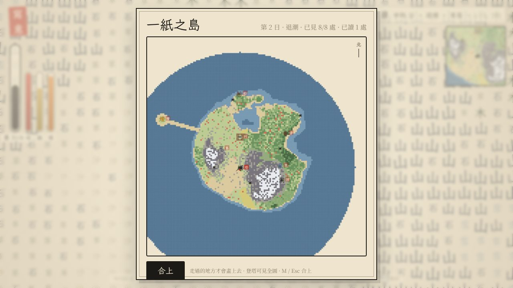

# 寫意 · Xiěyì

> 寫木成木，寫水成水。一紙之島。

一個**由漢字構成的探索與生存沙盒**，以**繁體字的構形**為規則。純瀏覽器單頁遊戲，零依賴，雙擊即玩。





## 為什麼是繁體

繁體保留了很多簡體丟掉的構字線索，遊戲直接拿它們當規則：

| 構形 | 在遊戲裡 |
| --- | --- |
| 島 ＝ 鳥 ＋ 山 | 這座島的名字；黃昏時鳥飛回塔，停在山上 |
| 筆 ＝ 竹 ＋ 聿；墨 ＝ 黑 ＋ 土；紙 ＝ 糸 ＋ 氏 | 你手裡的筆、你的資源、你腳下的世界 |
| 燈 ＝ 火 ＋ 登 | 登塔學會「登」，火上加登便是一盞長明的燈 |
| 問 ＝ 門 ＋ 口 | 對著村口的門寫「口」，門會告訴你最近一處沒讀過的地方在哪 |
| 間 ＝ 門 ＋ 日 | 門中有日，是一間屋，入內則暖 |
| 籠 ＝ 竹 ＋ 龍 | 洞中學會「龍」之後，竹上寫龍便是籠，連虎都收得進囊 |
| 漁 ＝ 水 ＋ 魚 | 把魚放回水裡成了魚梁，隔一陣子就有魚 |
| 塵 ＝ 鹿 ＋ 土；泉 ＝ 白 ＋ 水；麓 ＝ 林 ＋ 鹿 | 字典裡的小註腳 |

筆畫數採台灣教育部標準（艹 算四畫）：鳥 11、魚 11、龍 16、門 8、燈 16、藥 19、牆 17、灘 22。字體用霞鶩文楷 TC，離線回退標楷體。

## 創意在哪

關卡制的文字遊戲靠"這一關必須組出某個字"逼出樂趣；開放世界沒有"逼"，樂趣只能來自世界本身值得走過去看。所以《寫意》的重心是**探索**，組字造詞退為工具：

0. **遠處有東西。** 島上八處大字地標：塔、寺、村、船、泉、墓、洞、燈。地圖只畫你走過的地方，像在宣紙上一筆筆畫出來；登塔可以"看見整張紙"。島外有一座小嶼，只有退潮時沙路才露出來，燈在那裡。黃昏時鳥飛回塔、鹿走向泉，動物會帶路。走的人多了，草地會變成路。
   每處地標留了一段話，連起來是這張紙的來歷：它是誰寫的，先生用硃筆圈了什麼，錯字埋在哪裡。讀完八處，就讀完了這座島。
1. **世界即文字。** 一座程式生成的小島，每一格就是一個字：山、水、木、田、草、沙、雪、果、竹……用的是字而不是貼圖。你是一個「人」字。
2. **取字入囊，研字為墨。** 面向一個字按 E，它就進了你的囊，紙面留白。囊中之物可以研成墨，得到與它**筆畫數相同**的墨（森 12 畫，山只有 3 畫）。寫一個字也付出筆畫數的墨。天地之墨，不增不減。
3. **兩種合成，都是漢語本來的結構。** 沒有合成臺、沒有配方書。
   - **組字**（寫在地上的字上）：木 + 木 = 林，土上寫火 = 灶，田上寫木 = 果，日 + 月 = 明，人 + 木 = 休。
   - **造詞**（寫在囊中之物上）：火 + 把 = 火把，石 + 刀 = 石刀，木 + 屋 = 木屋，草 + 衣 = 草衣，竹 + 筏 = 竹筏，草 + 藥 = 草藥。魚和肉放到灶上，就成了烤魚、烤肉。
   你的物品欄就是一份詞彙表。
4. **學字即探索。** 取走沒見過的字、合成新字、讀碑，都會學會寫它。島上五塊碑由近到遠各教一個字：把、屋、衣、藥、筏。想做火把，得先找到第一塊碑。
5. **活下去。** 命、飽、暖三條數值。夜裡冷，雪上和水中更冷；久了餓；虎踞深森，夜裡出獵，畏火與光。生魚生肉傷身，灶上烤之則美。命盡則"墨盡"，囊落原地，可以回去取。
6. **一些小詩意。** 月亮只在夜裡沉在水面，要從岸邊把它"撈"上來；日光落在沙與雪上，白天才拾得到。用「口」困住一隻鹿，可以把它收進囊裡，放到別處它還是活的——寫鹿成鹿。吸空的白紙不會永遠留白：天地有常，舊字會慢慢自己長回來。

## 執行

```bash
# 方式一：直接雙擊 index.html（Chrome / Edge / Firefox 都可以）
# 方式二：起一個靜態伺服器（推薦，書法字型與存檔更穩定）
python3 -m http.server 8123
# 然後開啟 http://127.0.0.1:8123/
```

URL 引數：`?seed=123` 指定世界種子；`?autostart=1` 跳過開場直接進遊戲（測試用）。

書法字型「馬善政楷體」來自 Google Fonts，離線時自動回退到系統楷體，不影響遊玩。

## 操作

| 鍵 | 作用 |
| --- | --- |
| `W A S D` / 方向鍵 | 走（八方向，面朝最後按的方向） |
| `E` / 空格 | 取：吸面前的字入囊，按住可連取；面向魚是捉，面向鹿虎是獵（需石刀），面向碑是讀碑，面向日/月影是拾取 |
| `Tab` | 在「字」行（字典，寫字付墨）與「囊」行（囊中之物，放下不付墨）之間切換 |
| `F` / 回車 | 字行：把選中的字寫到面前；囊行：把選中之物放到面前（放在灶上是烤或添柴） |
| `C` | 造詞：在選中的囊中之物上寫一個字（再按數字選字） |
| `V` | 用：吃掉選中的食物 |
| `X` | 研墨：把選中之物化為墨 |
| `1`–`9` · `[` `]` · 滾輪 | 當前行內選擇 / 翻頁 |
| `R` | 站在「休」或木屋中休息，睡到天明 |
| `M` · `J` | 全島地圖（只畫走過的地方） · 見聞錄（地方、生靈、字、日子） |
| `N` · `H` · `+ -` | 靜音 · 幫助 · 縮放 |
| 滑鼠 | 左鍵寫/放、右鍵取（限相鄰格） |

## 現在的組字表與詞表（v0.2）

| 底字 + 所寫 | 結果 | 一句話 |
| --- | --- | --- |
| 木 + 木 / 林 + 木 | 林 / 森 | 雙木成林，三木成森，虎踞其中 |
| 水 + 水 | 淼 | 深水，有魚 |
| 火 + 火 / 炎 + 火 | 炎 / 焱 | 火勢更猛、照得更遠 |
| 石 + 石 | 磊 | 不可逾越的牆 |
| 日 + 月 | 明 | 燈。夜可照路，虎不敢近 |
| 木 + 人 | 休 | 營地，可睡到天明 |
| 土 + 火 | 灶 | 不蔓延的火。烤食、取暖，添木續火 |
| 田 + 木 | 果 | 果樹。摘之可食 |
| 水 + 木 / 水 + 石 | 橋 / 石 | 過水的兩種辦法；土遇水則散 |
| 土 + 水 / 灰 + 水 | 田 | 走得飛快的路 |
| 木 + 口 | 困 | 牆；口寫在獸上則困住它 30 秒 |
| 門 + 口 / 門 + 日 | 問 / 間 | 問路；一間屋 |
| 水 + 魚（囊中之魚放回水裡） | 漁 | 魚梁，每隔一陣子有魚 |
| 火 + 可燃物 | 燃燒 | 火起於林，勢不可擋；灰 → 土 → 草 → 木 慢慢復甦 |
| 水 + 火 / 燃燒物 | 土 / 滅火 | 水克火 |
| 雪 + 火 | 水 | 雪遇火成水 |

| 囊中之物 + 所寫 | 結果 | 一句話 |
| --- | --- | --- |
| 火 + 把 | 火把 | 夜裡自燃，照路三格，禦寒；燃盡即無 |
| 石 + 刀 | 石刀 | 採集快一倍；可獵鹿、鬥虎 |
| 木 + 屋 | 木屋 | 放在白紙上即成屋。入內則暖，獸不得入 |
| 草 + 衣 | 草衣 | 禦寒減半 |
| 竹 + 筏 | 竹筏 | 可行於淺水 |
| 草 + 藥 | 草藥 | 療傷 |
| 火 + 登 | 燈 | 長明不滅的燈；「登」從塔上學來 |
| 竹 + 龍 | 籠 | 面向獸放下即收入囊；籠可再用 |
| 魚 / 肉 放在灶上 | 烤魚 / 烤肉 | 飽 +40 / +55 |

| 地標 | 讀它會發生什麼 |
| --- | --- |
| 塔 | 看見整張紙：全島畫到地圖上 |
| 寺 | 屋內一樣暖，獸不得入，可睡 |
| 村 | 井水可飲（每日一次，命 +15） |
| 船 | 船裡有一隻竹筏 |
| 泉 | 傍邊療傷；黃昏鹿來 |
| 墓 | 錯字也是墨：墨 +10 |
| 洞 | 學會寫「龍」。寫在白紙上，龍隨你同行，夜能照路，虎不敢近 |
| 燈 | 在潮道盡頭的小嶼上。八處都讀過，便讀完了這張紙 |

完整法則見 `src/glyphs.js`：`FUSE_LIST` 是組字表，`WORDS` 是詞表，各加一行就是一條新規則。

## 程式碼結構

```
index.html      頁面骨架與 HUD
style.css       宣紙、墨、硃砂印的介面
src/util.js     雜湊、可播種隨機數、fbm 噪聲
src/glyphs.js   字型檔（筆畫 / 通行 / 可燃 / 發光 / 可食）、組字表、詞表、島嶼與潮道生成、五塊碑、八處地標與它們的話
src/world.js    分塊世界 = 程式生成底稿 + 玩家差異層；潮汐；探索迷霧；小路；火勢、演替、復原；灶的柴火、落下的囊；存檔
src/entities.js 鳥、魚、鹿、虎的行為，日月光影，墨點
src/render.js   水墨渲染：宣紙紋理、滲墨字形快取、大字地標、晝夜光照、迷霧小地圖、全島地圖
src/sfx.js      Web Audio 現場合成的筆觸 / 吸墨 / 合字 / 虎吼
src/game.js     主迴圈、輸入、取/寫/放/造詞/研墨/吃/獵/讀碑/讀地標/休息、命飽暖、死亡與復活、見聞錄、HUD、存檔
scripts/smoke.mjs  無頭瀏覽器冒煙測試（跑一遍核心玩法並截圖）
```

幾個值得一提的實現選擇：

- **世界只存差異。** 底稿由 `(x, y, seed)` 雜湊決定，可復現；島的邊緣是高度場隨半徑衰減出來的，不是貼邊。玩家改動的格子放在一個稀疏表裡，存檔只有幾 KB。白紙"自愈"就是把差異層慢慢刪掉。
- **潮汐是一種地貌。** 潮道的格子底稿是「灘」，讀取時按時辰解釋為沙或水，存檔裡什麼都不用存。小嶼到島心的直線上，水變潮道、山變石徑，所以四十個種子裡燈都走得到，而且只在退潮時走得到。
- **探索迷霧按區塊存點陣圖。** 每半秒把玩家周圍九格標為"看過"，地圖與小地圖只畫看過的格子；登塔一次標八十格半徑。
- **兩種合成共用一個動詞。** "寫在地上的字上"是組字，"寫在囊中的字上"是造詞，都是 `evalWrite` / `wordFor` 一張表查出來的；灶上的烤與添柴也只是"放"的特例。
- **字形快取。** 每個字按顏色只渲染一次（先一層模糊的滲墨再一層實筆），之後全是 `drawImage`；逐格的旋轉、縮放抖動來自座標雜湊，所以同一個字每次看都長一樣。
- **模擬只在玩家附近取樣。** 火每半秒按鄰格可燃度蔓延，分支因子疏木約 1、林約 1.4、森約 1.7：一把火燒不掉一片疏林，但進了深林就失控。演替每步隨機取樣 300 格，只作用於被改動過的格子，底稿本身是穩定的。
- **虎的追擊速度 0.24 秒/格，你在田上 0.11 秒/格、在森裡 0.34 秒/格。** 所以開闊地跑得掉，深林跑不掉——地貌本身就是難度。
- **生存數值的節奏。** 飽約 8 分鐘耗盡（兩個晝夜）；夜長約 110 秒，暖每秒 −1，所以第一夜沒有火就會凍到臨界；灶邊每秒 +4，屋內 +5，草衣減半，火把減六成。這些數字都在 `updateStats` 一處。

測試：

```bash
python3 -m http.server 8123 &
NODE_PATH=$(npm root -g) node scripts/smoke.mjs   # 需要全域性或本地安裝 playwright
```

## 取捨與已知問題

- **2D 俯視格子，而不是 3D。** 這是刻意的：規則、世界生成、實體系統與渲染是分開的，之後要做 3D 只需把 `render.js` 換成 three.js 的立體字塊，字型檔與世界完全複用。先把"玩法是否成立"驗證出來，再談視角。
- **平衡只是第一版。** 火勢、演替速度、虎的侵略性、飢寒速度、墨量上限這些數字都在一兩個常量裡，沒有經過多人試玩。探索版把飢寒放緩了（飽約 12 分鐘、夜寒每秒 −0.7），讓人有工夫走遠。
- **生存層與《饑荒》一類遊戲共享的是型別慣例**（飢餓、體溫、晝夜、採集、合成），這些是不受著作權保護的玩法概念；美術、道具名、介面、文案全部是本作自己的表達。詳見下節。
- **移動端沒有適配**（沒有虛擬搖桿），窄屏會隱藏部分 HUD。
- **存檔在瀏覽器 localStorage**，換瀏覽器或清快取就沒了；每 20 秒、建營地、休息、關頁面時自動存。
- 無頭瀏覽器（軟體渲染）約 35 fps；真實瀏覽器應穩定 60。

## 靈感來源與差異

用文字當遊戲世界不是新點子：Scribblenauts（寫詞造物）、Baba Is You（詞即規則）、Typoman（字母即物件）、Team9 的《文字遊戲》（刪推拆組、線性敘事解謎）、《字裡行間》（推字塊拆合漢字）都在前面。《寫意》有意避開它們的表達，往另一個方向走：

- 沒有關卡；一座程式生成的島、一套生態、八處留了話的地方。故事靠走到那裡讀到，不靠過關。
- 核心不是解謎，而是探索（地圖、潮汐、動物帶路）、經濟（筆畫守恆）與生存（命飽暖）。
- 合成同時用組字與造詞兩種漢語結構；物品欄就是詞彙表。
- 視覺是宣紙、書法、硃砂印，不是黑底白字。

## 路線圖（接下來可以做的）

1. **把八段話寫厚。** 現在的故事只有一層（一個學字的孩子、一位用硃筆的先生）；下一步讓季節、天氣、第二遍再讀時的變化把它寫厚。
2. **農事。** 田 → 苗 → 禾 → 米 → 飯；四時節氣，雪線隨季節上下。
3. **天氣。** 雨部是繁體最豐富的一族：雲、電、雷、霧、露、霖、霜、靈；雨滅火、漲水、潤土，風吹火、吹沙，雷點火。
4. **更多字與詞。** 艹 + 田 = 苗，林 + 火 = 焚，小 + 土 = 塵，魚 + 羊 = 鮮；皮 + 衣 = 皮衣；用「口」圍出一圈：國、園、囿。
5. **「人」的社會。** 人 + 人 = 從（跟隨者），三人成眾（結社）。
6. **多人：同一張紙。** 世界只存差異，天然適合同步。
7. **3D 立體字塊版**。

## 許可

MIT。隨意寫、隨意改。
