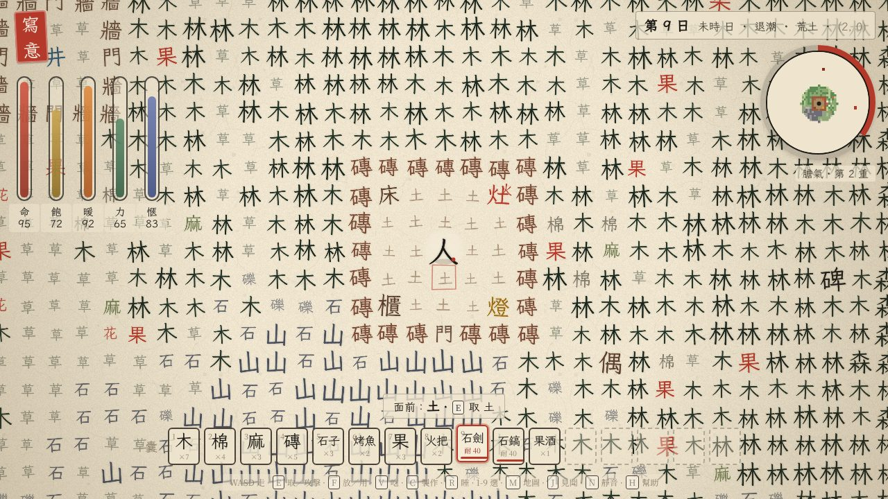
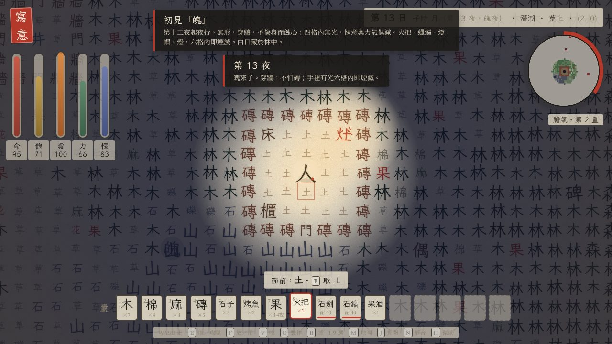

# 寫意 · Xiěyì

> 鳥棲於山，是為島。一張紙落在海上，紙上的字活了。

一個**由漢字構成的生存與探索沙盒**：收集、製作、砌牆，撐過一夜又一夜；蛇在草木之交，豹狼在林與夜；第十三夜起，魄夜行。純瀏覽器單頁遊戲，零依賴，雙擊即玩。全繁體。






## 玩法循環

1. **取**：面向一個字按 E。樹得木，野棉得棉，野麻得麻，碎石地（礫）得石子，石地得石，果樹得果。山與磊要用鎬。草 30 秒、樹 180 秒、果樹 210 秒、棉麻 150 秒會長回來。除草有十分之一驚出蜘蛛。
2. **製作**（C，耗力，愜意 +8，膽氣 +耗力值）：磚＝土二草一；門＝木三；床＝棉六木二；櫃＝石四木四；灶＝石六；火把＝木一草二；蠟燭＝棉一肉一；燈＝石二火把一；衣＝棉四；麻布＝麻四棉二；燈帽＝麻布二蠟燭一；稻草人＝麻布二石子二木三草四；藥＝草三果一；果酒＝醉果二淡水一；橋、竹筏、魚梁；木板、船槳、船帆、大船（膽氣八重）。
3. **磨礪**：石一、石子一、木一，選刀、鎬、鋤、劍、斧。工具有耐久，鈍了用石子重磨。
4. **放**（F）：磚與門擋得住獸（魄能穿）；稻草人三十天內獸不近身，前半十格、後半七格，再放一個續到四十天。魚、肉、蛇肉、蟾蜍放在旺的灶上烤熟；沙三燒成兩個玻璃瓶；海水瓶蒸餾成淡水。鋤面向土成田。
5. **睡**（R）：夜裡面向床一覺到天明，愜意 +20；附近有魄睡不著。野果放過十五夜變醉果，吃了昏迷一刻（六十息，五倍速過，周圍照常），醒來飽 +2、愜意 +1、力 −5。
6. **夜與獸**：虎、豹畏火光；狼夜裡成群不怕火，磚與門擋得住；蛇主動咬，蜘蛛與毒蟾不惹不咬。被咬五秒內每秒三滴血，六秒內連咬十五口必死，藥可解毒。第十三夜起魄夜行：穿牆，不傷身而蝕心，四格內無光愜意每秒 −3、力 −2；手持火把或蠟燭、戴燈帽、地上有燈，六格內即煙滅；白日藏於林中。
7. **探索與渡海**：地圖只畫走過的地方，登塔可見全圖。島上八處各留一段話；村口的門可問路。膽氣八重造大船，放在淺水上，上船可渡深海，開到海的盡頭便渡海而去，可以帶著膽氣再來一座島。

六條數值：**命**（餓、冷、力盡、毒、獸都會耗；飽、愜意、力都在八成以上才回）、**飽**（渴與飢算在一起，淡水與酒也能解）、**暖**、**力**（每兩息回一點，取一次打一下各耗一點，製作另計，力盡掉血）、**愜意**（每十五息掉一點；製作、睡床、果酒、烤蟾蜍、讀地標回；每分鐘聽見鹿呦、鳥鳴、海浪各 +1；歸零則神志不清，畫面泛藍）、**膽氣**（採集、製作、擊敗野獸都長，右上地圖一圈一重，越高回復越快，十重兩倍；死則歸零）。畫面：掉血泛紅、中毒泛綠、神志不清泛藍。

## 操作

| 鍵 | 作用 |
| --- | --- |
| `W A S D` / 方向鍵 | 走（八方向，面朝最後按的方向） |
| `E` / 空白 | 取（按住可連取）／攻擊／捉魚／讀碑讀地標／問路／取魚梁的魚／撿囊 |
| `F` / Enter | 放下手裡的東西／在灶上烤或添柴／鋤地 |
| `V` | 吃 |
| `C` | 製作（數字鍵直接造） |
| `R` | 夜裡面向床睡到天明 |
| `1`–`9` · `[` `]` · 滾輪 | 選手裡的東西 |
| `M` · `J` · `N` · `H` · `+ -` | 地圖 · 見聞錄 · 靜音 · 幫助 · 縮放 |
| 滑鼠 | 左鍵取、右鍵放（相鄰格） |

## 工具

| 工具 | 用處 |
| --- | --- |
| 石刀 | 獵鹿一刀；打虎三刀；蛇蛛蟾三刀 |
| 石劍 | 傷害二：虎兩劍、豹狼兩劍、蛇蛛蟾兩劍。魄打不著，用光 |
| 石鎬 | 鑿山（得石二）、採磊、拆磚，石地快一倍 |
| 石斧 | 伐木伐竹快一倍 |
| 石鋤 | 面向土或草按 F，鋤成田 |

## 地標

| 地標 | 讀它會發生什麼 |
| --- | --- |
| 塔 | 看見整張紙：全島畫到地圖上 |
| 寺 | 屋內一樣暖，獸不得入，可睡 |
| 村 | 井水可飲（每日一次，命 +15）；門可問路 |
| 船 | 船裡有一隻竹筏 |
| 泉 | 傍邊療傷；黃昏鹿來 |
| 墓 | 錯字砌的磚：磚 ×6、石子 ×3 |
| 洞 | 龍跟你走。夜能照路，獸與魄不敢近 |
| 燈 | 在潮道盡頭的小嶼上。八處都讀過，便讀完了這張紙 |

## 執行

```bash
python3 -m http.server 8123     # 然後開 http://127.0.0.1:8123/ ，或直接雙擊 index.html
```

URL 參數：`?seed=123` 指定世界種子；`?autostart=1` 跳過開場。書法字體「霞鶩文楷 TC」來自 Google Fonts，離線時回退標楷體。

測試與打包：

```bash
NODE_PATH=$(npm root -g) node scripts/smoke.mjs     # 無頭瀏覽器跑一遍核心玩法（需要 playwright）
python3 scripts/build-single.py --page             # 打包成單檔 dist/index.html
```

## 程式碼結構

```
index.html      頁面骨架與 HUD
style.css       宣紙、墨、硃砂印的介面
src/util.js     雜湊、可播種隨機數、fbm 噪聲
src/glyphs.js   字庫（取之得什麼、要什麼工具）、物品與工具、配方、島嶼與潮道生成、五塊碑、八處地標
src/world.js    分塊世界 = 程式生成底稿 + 玩家差異層；潮汐；探索迷霧；小路；火勢、演替、復原；灶、魚梁、落囊；存檔
src/entities.js 鳥、魚、鹿、虎、豹、狼、蛇、蛛、蟾、龍的行為；第十三夜起怕光穿牆的魄；稻草人的迴避
src/render.js   水墨渲染：宣紙紋理、滲墨字形快取、大字地標、晝夜光照、迷霧小地圖、全島地圖
src/sfx.js      Web Audio 現場合成的音效
src/game.js     主迴圈、輸入、取／攻擊／放／製作／吃／睡／上船、命飽暖力愜與膽氣、毒與魄、昏迷、櫃、瓶與酒、渡海、見聞錄、HUD、存檔
scripts/smoke.mjs      Playwright 冒煙測試
scripts/build-single.py 單檔打包
```

幾個實作選擇：

- **世界只存差異。** 底稿由 `(x, y, seed)` 雜湊決定，可複現；玩家改動的格子放在稀疏表裡，存檔只有幾 KB。白紙「自癒」是把差異層慢慢刪掉；摘過的果樹、採過的棉會長回來。
- **潮汐是一種地貌。** 潮道的底稿是「灘」，讀取時按時辰解釋為沙或水。小嶼到島心的直線上，水變潮道、山變石徑，所以燈都走得到，而且只在退潮時走得到。
- **擋路靠格子本身。** 獸的 `canStand` 不能站上 walk 為 0 的格（磚）、門、屋內、稻草人的範圍，所以一圈磚加一扇門就是避難所，不需要另外判斷「封閉」。
- **魄只怕光，不怕牆。** 牆擋獸、光擋魄，兩種威脅要兩套準備：磚門稻草人對獸，火把蠟燭燈帽對魄。魄只在玩家周圍 12 到 20 格、六格內無光處出生。
- **昏迷是用五倍速跑同一個更新迴圈。** 醉果的一刻鐘裡世界照常，蛇照咬、魄照來，玩家看得見但動不了。

## 取捨與已知問題

- 2D 俯視格子，不是 3D。規則、世界生成、實體與渲染分層，以後換渲染器即可。
- 數值平衡沒經過真人試玩：工具耐久 40、豹狼一撲 10、蛇毒每秒 3、醉果 15 夜，都是第一版數字，全在 `src/glyphs.js` 與 `src/game.js` 頂部的常數裡。
- 數值全是第一版：毒、膽氣每重 20 點、愜意每 15 秒 1 點、稻草人半徑，都在 `src/glyphs.js` 與 `src/game.js` 頂部常數裡。
- 手機沒有虛擬搖桿。存檔在瀏覽器本地。

## 靈感來源與差異

Minecraft（收集、製作、避難所、夜裡的怪）、Don't Starve（飢餓、體溫、日夜）、Team9 的《文字遊戲》、《字裡行間》都在前面。《寫意》的不同：世界與物品都是漢字，介面是宣紙與楷書，地圖是走出來的，故事靠走到那裡讀到。繁體的構形留在字裡：島＝鳥＋山，塵＝鹿＋土，泉＝白＋水。

## 路線圖

1. **農事**：鋤成田之後，種果、種棉、種麻；四時節氣。
2. **渡海之後**：帶著膽氣來到的下一座島，該有些不一樣的東西。
3. **天氣**：雨部是繁體最豐富的一族：雲、電、雷、霧、露、霖。
4. **村民**：人在字典裡，總有一天會走出來。

## 許可

MIT。隨意寫、隨意改。
